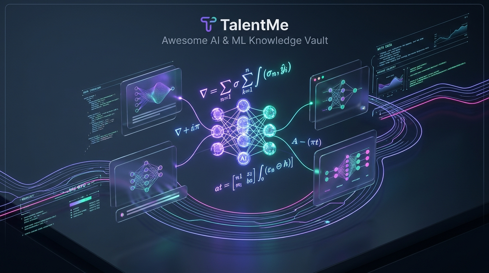
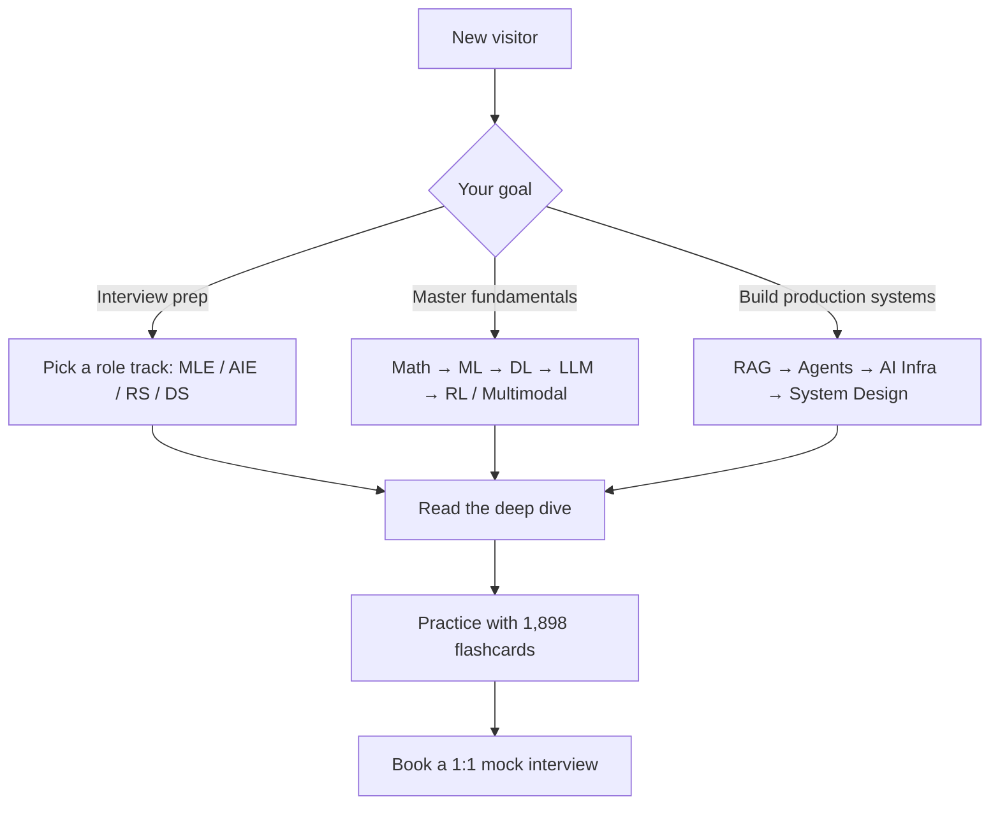
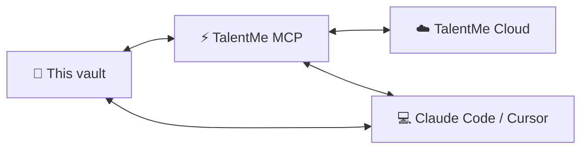

<div align="center">



# 🧠 AI / ML / LLM Interview Vault

**77 bilingual deep dives · 477 atomic knowledge cards · 1,898 free flashcards**

From SVD to vLLM: the math, the systems, and the interview answers — in one repository.

<p align="center">
  <a href="https://talentme.airsota.com/tools/flashcards?utm_source=github&utm_medium=readme&utm_campaign=vault"></a>
  <a href="https://talentme.airsota.com/resources/tech/roadmap?utm_source=github&utm_medium=readme&utm_campaign=vault"></a>
  <a href="https://talentme.airsota.com/contact?utm_source=github&utm_medium=readme&utm_campaign=vault"></a>
</p>

<p align="center">
  <a href="https://github.com/airsota/TalentMe-Awesome-AI-ML-Interview-Vault/stargazers"></a>
  <a href="https://github.com/airsota/TalentMe-Awesome-AI-ML-Interview-Vault/commits/main"></a>
  
  
  
  <a href="LICENSE"></a>
</p>

<p align="center">
  <sub>Every guide is bilingual (English + 中文). ⭐ Star the repo to support the work — it helps more engineers find it.</sub>
</p>

</div>

---

## 🚀 New here? Start with one of these

| I want to… | Start here |
|---|---|
| **Prepare for an MLE interview** | [MLE Role Track →](Interviews/MLE/) |
| **Prepare for an AI systems (AIE) interview** | [AIE Role Track →](Interviews/AIE/) |
| **Prepare for a research scientist (RS) interview** | [RS Role Track →](Interviews/RS/) |
| **Prepare for a data scientist (DS) interview** | [DS Role Track →](Interviews/DS/) |
| **Master LLM internals** | [Transformer Architecture](Foundations/LLM/transformer-architecture.en.md) → [KV Cache & PagedAttention](Foundations/AI_Infra/kv-cache-and-paged-attention.en.md) → [MoE](Foundations/LLM/moe-architecture.en.md) |
| **Learn RLHF / DPO / GRPO** | [Preference Alignment](Foundations/LLM/alignment-and-rlhf-dpo.en.md) |
| **Build production RAG** | [RAG Systems](Foundations/AI_Engineering/naive-and-advanced-rag.en.md) → [Vector DBs & HNSW](Foundations/AI_Engineering/vector-databases-and-hnsw.en.md) → [LLM-as-a-Judge](Foundations/AI_Engineering/llm-as-a-judge.en.md) |
| **Build agents** | [Agent Design Patterns](Foundations/AI_Engineering/agent-design-patterns.en.md) → [Tool Use](Foundations/AI_Engineering/tool-use-and-function-calling.en.md) |
| **Learn distributed training & inference** | [Distributed Parallelism](Foundations/AI_Infra/distributed-parallelism.en.md) → [Speculative Decoding](Foundations/AI_Infra/speculative-decoding.en.md) |
| **Design industrial AI systems** | [System Design Modules →](Foundations/System_Design/) |
| **Browse all 2,385 interviewer questions** | [Question Bank →](QUESTION-BANK.md) |
| **See the full map** | [Full Index](INDEX.md) |



---

## 📚 The full map

### Foundations — 60 guides across 9 modules

| Module | Guides | Cards | What it covers | Index |
|---|:--:|:--:|---|---|
| 📐 **Math & Optimization** | 6 | 32 | Linear algebra, probability, MLE/MAP, KKT, matrix calculus, Monte Carlo | [Open](Foundations/Math/README.md) |
| 📊 **Classic Machine Learning** | 6 | 44 | Regression, SVM, trees/GBDT, clustering, probabilistic models, metrics | [Open](Foundations/ML/README.md) |
| 🧠 **Deep Learning** | 8 | 38 | CNN/ViT, RNN/LSTM/Mamba, optimizers, normalization, GANs, GNNs | [Open](Foundations/DL/README.md) |
| ⚡ **Large Language Models** | 10 | 48 | Transformers, RoPE, attention variants, tokenizers, MoE, PEFT, quantization, alignment, reasoning | [Open](Foundations/LLM/README.md) |
| 🎮 **RL & Post-Training** | 5 | 38 | MDP, deep RL, bandits, offline RL, agentic RL, RLHF/DPO/GRPO | [Open](Foundations/RL/README.md) |
| 👁️ **Multimodal & Diffusion** | 5 | 37 | CLIP, vision-language models, diffusion, audio/speech, world models | [Open](Foundations/Multimodal/README.md) |
| 🖥️ **AI Infrastructure** | 8 | 32 | GPU/HBM, distributed parallelism, cluster scheduling, KV cache, speculative decoding, MLOps | [Open](Foundations/AI_Infra/README.md) |
| 🤖 **AI Engineering** | 6 | 65 | RAG, vector DBs, agents, tool calling, prompt guardrails, LLM-as-a-judge | [Open](Foundations/AI_Engineering/README.md) |
| 🏗️ **System Design** | 6 | 43 | Recommendation, search/ads, risk control, LLM/RAG/agent systems, multimodal systems | [Open](Foundations/System_Design/README.md) |

### Interviews — 17 guides across 4 role tracks

| Role track | Guides | Cards | Focus | Index |
|---|:--:|:--:|---|---|
| 💻 **MLE** — Machine Learning Engineer | 5 | 25 | RecSys, search/ads, feature engineering, live coding, model evaluation | [Open](Interviews/MLE/README.md) |
| 🚀 **AIE** — AI Systems Engineer | 4 | 25 | Production RAG, agents, fine-tuning, vLLM serving, system design | [Open](Interviews/AIE/README.md) |
| 🎓 **RS** — Research Scientist | 4 | 25 | Paper deconstruction, alignment math, scaling laws, experiment design | [Open](Interviews/RS/README.md) |
| 📈 **DS** — Data Scientist | 4 | 25 | Causal inference, A/B testing, uplift modeling, experiment design | [Open](Interviews/DS/README.md) |

---

## 🎯 Why this vault

Most "AI interview" repositories are link lists or bullet-point summaries. This one is built like a technical book:

| This vault | Typical interview lists |
|---|---|
| **77 bilingual deep dives** with closed-form derivations, not hand-waving | Bullet summaries with no math |
| **477 atomic knowledge cards**, each with 5 interviewer follow-ups | Repeated generic questions |
| **Pure Python / NumPy operators** you can run and modify | Pseudocode that never compiles |
| **9 foundation modules + 4 role tracks** — learn bottom-up or top-down | One flat, unranked list |
| **1,898 free flashcards** for active recall on the live site | Static PDFs |
| **Synced from a continuously updated platform** | Stale after the first publish |

**This vault IS:**
- A rigorous reference for ML / DL / LLM / RAG / agents / AI infrastructure.
- An interview companion with role-specific tracks and high-frequency follow-ups.
- Bilingual: every guide ships as `.en.md` and `.zh.md`.

**This vault is NOT:**
- A beginner Python or PyTorch tutorial.
- A news feed or paper digest (that lives on the website).
- A replacement for hands-on practice — read it next to a real project.

---

## 🔥 Active recall: 477 cards, 1,898 flashcards

Every deep dive ends with **five interviewer follow-ups** — the questions that actually decide the interview, not the definitions. For example, the preference-alignment guide ends with:

> *Derive how DPO eliminates the explicit reward model and the partition function Z(x) via closed-form substitution.*

> *Compare the PPO four-model setup with DeepSeek-R1's critic-free GRPO. How does GRPO halve VRAM?*

Reading builds recognition. Answering builds recall. The same knowledge is available as a **3-layer progressive flashcard drill** on TalentMe:

**[🃏 Practice all 1,898 flashcards free →](https://talentme.airsota.com/tools/flashcards?utm_source=github&utm_medium=readme&utm_campaign=vault&utm_content=flashcards-cta)**
**[🎯 Browse the full 2,385-question bank by module →](QUESTION-BANK.md)**

- Layer 1: problem framing and the one-line answer
- Layer 2: formula, derivation, and mechanism
- Layer 3: industrial code, edge cases, and interviewer follow-ups

No sign-up required. **1,898 questions**, including 69 hand-written PyTorch/NumPy operators and 973 coding problems.

---

## 🛠️ Pure Python, zero heavy dependencies

The core algorithms ship as self-contained Python / NumPy implementations, not pseudocode:

```python
# Determinantal Point Processes (DPP) greedy selection — RecSys diversity
import numpy as np

def dpp_greedy(quality: np.ndarray, similarity: np.ndarray, k: int = 3) -> list[int]:
    L = np.outer(quality, quality) * similarity
    selected: list[int] = []
    for _ in range(k):
        best_gain, best_idx = -1.0, -1
        for candidate in range(len(quality)):
            if candidate in selected:
                continue
            sub = L[np.ix_(selected + [candidate], selected + [candidate])]
            gain = np.linalg.det(sub)
            if gain > best_gain:
                best_gain, best_idx = gain, candidate
        if best_idx == -1 or best_gain <= 0:
            break
        selected.append(best_idx)
    return selected
```

You will find the same style across LoRA/QLoRA VRAM calculus, PPO clipped loss, DPO implicit-reward substitution, GRPO, FlashAttention online softmax, PagedAttention, CUPED variance reduction, and more.

---

## 🧠 Use it as a local second brain (Obsidian)

Every document is native Markdown with standard YAML frontmatter, KaTeX math, and Mermaid diagrams:

1. `git clone https://github.com/airsota/TalentMe-Awesome-AI-ML-Interview-Vault.git`
2. Open **Obsidian** → **Open folder as vault** → select the cloned folder.
3. Press `Ctrl/Cmd + G` to open the knowledge graph.

The same vault works with Logseq, Foam, and any Markdown editor.

---

## ⚡ Supercharge it with the TalentMe MCP server

This repository is not just static text. Connect it to the [TalentMe MCP server](https://github.com/airsota/talentme-mcp) and your AI assistant (Claude Code, Cursor, Windsurf) can read your local vault, query the cloud knowledge base, run mock interviews, and log weak spots back into your notes.



```bash
pip install -e /path/to/talentme-mcp
talentme start --init-memory /path/to/this/vault
```

Then ask your assistant to *"mock interview me on DPO and log the gaps"*. The MCP server is open source: [github.com/airsota/talentme-mcp](https://github.com/airsota/talentme-mcp).

---

## ❓ FAQ

### What is this repository?
A bilingual AI/ML/LLM knowledge vault for interview preparation: 77 deep dives, 477 atomic cards, 2,385 interviewer questions, and role tracks for MLE, AIE, RS, and DS. It mirrors the technical content of [TalentMe](https://talentme.airsota.com/resources/tech?utm_source=github&utm_medium=readme&utm_campaign=vault).

### Is it free?
Yes. The repository is MIT-licensed and the flashcards on the website are free without sign-up.

### How is this different from other AI interview repositories?
Three things: rigorous derivations (not bullet summaries), a role-driven structure, and 1,898 active-recall flashcards that pair with every guide. Every guide also ends with five real interviewer follow-ups.

### Which roles does it cover?
MLE (recommendation, search/ads, feature stores), AIE (production RAG, agents, fine-tuning, serving), RS (paper deconstruction, alignment math, scaling laws), and DS (causal inference, A/B testing, uplift).

### Is the content bilingual?
Yes. Every article exists as both `*.en.md` and `*.zh.md`, with matching structure and formulas.

### How do I use it for interview prep?
Pick a role track, read the core guides, then practice with [1,898 flashcards](https://talentme.airsota.com/tools/flashcards?utm_source=github&utm_medium=readme&utm_campaign=vault). Finish with a [1:1 mock interview](https://talentme.airsota.com/contact?utm_source=github&utm_medium=readme&utm_campaign=vault) to stress-test your explanations under time pressure.

### Can I use it with Obsidian or an AI assistant?
Yes — it is a native Obsidian vault, and the [TalentMe MCP server](https://github.com/airsota/talentme-mcp) lets Claude Code / Cursor run mock interviews against it.

### How often is it updated?
The repository is synced from the live TalentMe Tech Vault via [`scripts/sync_vault.py`](scripts/sync_vault.py). See the `updated` badge at the top for the latest commit.

### Can I contribute?
Yes. Open an issue or PR for corrections, new derivations, or additional interview questions. See [Contributing](#-contributing).

### Can I use the content commercially?
The repository is MIT-licensed. Attribution is appreciated but not required. For bulk commercial use, please contact us first.

---

## 📂 Repository structure

```
.
├── Foundations/                 # 60 guides · 9 modules
│   ├── Math/
│   ├── ML/
│   ├── DL/
│   ├── LLM/
│   ├── RL/
│   ├── Multimodal/
│   ├── AI_Infra/
│   ├── AI_Engineering/
│   └── System_Design/
├── Interviews/                  # 17 guides · 4 role tracks
│   ├── MLE/
│   ├── AIE/
│   ├── RS/
│   └── DS/
├── QUESTION-BANK.md             # 2,385 interviewer questions · 13 modules
├── Question-Bank/               # Per-module question banks
├── INDEX.md                     # Auto-generated full index
├── scripts/sync_vault.py        # Website → repo sync + CTA injection
├── scripts/generate_question_bank.py
└── assets/
```

Each module has its own `README.md` index with English and Chinese links.

---

## ⭐ Star & Watch

If this vault saves you time:

- **Star the repo** — it helps other engineers find it.
- **Watch → Releases only** — get notified when new guides land.
- **Share a chapter** with someone preparing for an AI interview.

---

## 🤝 Contributing

1. Fork the repository.
2. Create a branch: `git checkout -b feature/add-grpo-derivation`.
3. Add your change and keep the bilingual parity (`.en.md` + `.zh.md`).
4. Open a pull request.

Errata, clearer derivations, and new interviewer follow-ups are especially welcome.

---

## 🔗 Links

- **Interactive vault**: [talentme.airsota.com/resources/tech](https://talentme.airsota.com/resources/tech?utm_source=github&utm_medium=readme&utm_campaign=vault)
- **1,898 flashcards**: [talentme.airsota.com/tools/flashcards](https://talentme.airsota.com/tools/flashcards?utm_source=github&utm_medium=readme&utm_campaign=vault)
- **973 coding problems**: [talentme.airsota.com/tools/neetcode](https://talentme.airsota.com/tools/neetcode?utm_source=github&utm_medium=readme&utm_campaign=vault)
- **1:1 mock interviews**: [talentme.airsota.com/contact](https://talentme.airsota.com/contact?utm_source=github&utm_medium=readme&utm_campaign=vault)
- **MCP server**: [github.com/airsota/talentme-mcp](https://github.com/airsota/talentme-mcp)
- **Daily AI news**: [github.com/airsota/TalentMe-AI-Daily](https://github.com/airsota/TalentMe-AI-Daily)

---

## 📄 License

[MIT](LICENSE) © TalentMe AI Team

<div align="center">
  <sub>Built with ❤️ by the TalentMe AI Team · Synced from <a href="https://talentme.airsota.com">talentme.airsota.com</a></sub>
</div>
